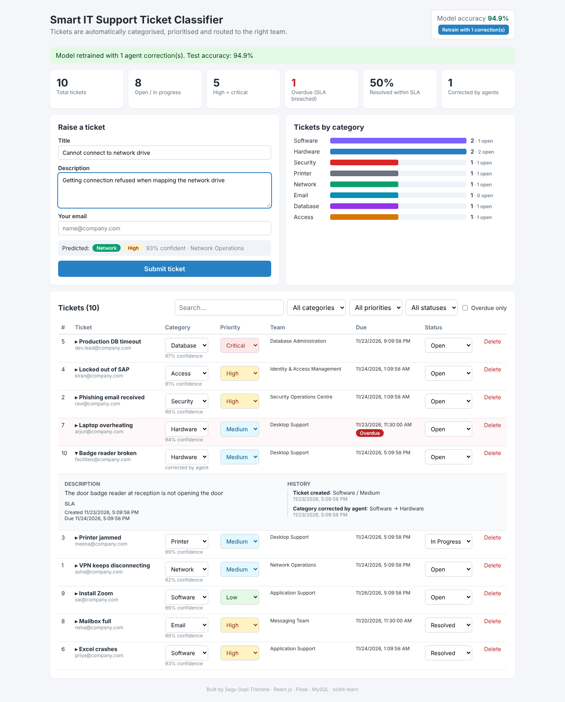

# Smart IT Support Ticket Classifier


A full stack web application that automatically **classifies IT support tickets into eight categories**, assigns a **priority and SLA deadline**, and **routes each ticket to the right support team**. A React dashboard lets support agents manage tickets, track overdue work, view an audit history and see category-based reports.

**Tech stack:** React.js · Python · Flask (REST API) · MySQL · scikit-learn · Docker · GitHub Actions



## Features

**Machine learning**
- **8-category classification:** a TF-IDF + Logistic Regression model reads the ticket text and predicts Hardware, Software, Network, Access, Email, Printer, Security or Database (**~95% test accuracy**).
- **Live prediction:** while a user types, the form shows the predicted category, priority, confidence and team.
- **Human-in-the-loop learning:** agents can correct a wrong category. One click on **Retrain** adds all corrected tickets to the training data, so the model learns from its mistakes.

**Ticket workflow**
- **Automatic priority:** keyword rules set Critical / High / Medium / Low (for example, "outage" or "production" → Critical). Security tickets are never below High.
- **Automatic routing:** each category goes to its owning team (Security → Security Operations Centre, and so on).
- **SLA tracking:** every ticket gets a deadline from its priority (Critical 4h, High 8h, Medium 24h, Low 72h). Overdue tickets are highlighted and can be filtered. Changing the priority moves the deadline.
- **Audit trail:** every change (status, priority, category correction) is recorded in a `ticket_history` table and shown as a timeline.
- **Manage tickets:** search, filter by category, priority, status or overdue; update status; delete. Open work is sorted by priority and nearest deadline.

**Reports**
- Tickets, open tickets, urgent tickets, overdue tickets and average model confidence **per category** (SQL `GROUP BY` with conditional `SUM(CASE ...)`).
- Totals by status and priority, overdue count, and **SLA compliance %** (resolved tickets closed before their deadline).

## Architecture

```
React dashboard (Vite / nginx)
        │  fetch /api/...
        ▼
Flask REST API ──► classifier.py ──► trained model (scikit-learn, joblib)
        │
        ▼
MySQL: tickets  1 ──── *  ticket_history   (foreign key, ON DELETE CASCADE)
```

## Database design

| Table | Purpose | Key columns |
|---|---|---|
| `tickets` | One row per ticket | `category`, `confidence`, `priority` (ENUM), `status` (ENUM), `assigned_team`, `due_at`, `resolved_at`, `manually_corrected` |
| `ticket_history` | Audit trail of changes | `ticket_id` (FK → tickets.id, cascade delete), `action`, `old_value`, `new_value`, `changed_at` |

Indexes on `category`, `status`, `priority` and `due_at` support the dashboard filters. All queries use parameterised placeholders, which prevents SQL injection. See `backend/schema.sql`.

## REST API

| Method | Endpoint | Description |
|---|---|---|
| GET | `/api/health` | Health check |
| POST | `/api/classify` | Classify text without saving `{ "text": "..." }` |
| POST | `/api/tickets` | Create a ticket `{ title, description, requester_email }` → 201 |
| GET | `/api/tickets` | List tickets. Filters: `category`, `status`, `priority`, `search`, `overdue=true` |
| GET | `/api/tickets/<id>` | Get one ticket |
| GET | `/api/tickets/<id>/history` | Audit trail for a ticket (SQL JOIN) |
| PATCH | `/api/tickets/<id>` | Update `status`, `priority` or `category` (manual correction) |
| DELETE | `/api/tickets/<id>` | Delete a ticket and its history → 204 |
| GET | `/api/reports/categories` | Per-category totals, open, urgent, overdue, avg confidence |
| GET | `/api/reports/summary` | Totals by status and priority, overdue, SLA compliance % |
| GET | `/api/model/metrics` | Model accuracy, dataset sizes, corrections used |
| POST | `/api/model/retrain` | Retrain the model including agents' corrections |

Example:

```bash
curl -X POST http://localhost:5000/api/classify \
  -H "Content-Type: application/json" \
  -d '{"text": "VPN keeps disconnecting every few minutes"}'
```

```json
{
  "category": "Network",
  "confidence": 0.92,
  "priority": "Medium",
  "assigned_team": "Network Operations",
  "alternatives": [ ... top 3 categories with confidence ... ]
}
```

## Machine learning model

- **Dataset:** 1,200 labelled tickets (150 per category) built by `generate_dataset.py` from realistic helpdesk phrasings. About 6% of labels are deliberately wrong, to mimic real helpdesk data where agents file tickets in the wrong queue.
- **Features:** TF-IDF on single words and 2-word phrases (for example "password reset"), English stop words removed.
- **Model:** multinomial Logistic Regression. It's fast, works well on short text, and gives probabilities, which are used as the confidence score.
- **Evaluation:** stratified 80/20 train/test split. Test accuracy **94.9%**. Per-category precision, recall and the confusion matrix are in `backend/model/metrics.json`.
- **Retraining:** corrected tickets are added to the training set only, so test accuracy stays comparable between versions.

## Project structure

```
smart-it-ticket-classifier/
├── backend/
│   ├── app.py                 # Flask REST API (tickets, SLA, history, reports, retraining)
│   ├── classifier.py          # prediction, priority rules, SLA hours, team routing
│   ├── db.py                  # MySQL / SQLite database layer
│   ├── train_model.py         # trains and evaluates the model
│   ├── generate_dataset.py    # builds the labelled ticket dataset
│   ├── wsgi.py                # production entry point (gunicorn)
│   ├── schema.sql             # MySQL tables, foreign key, indexes
│   ├── data/tickets_dataset.csv
│   ├── model/metrics.json
│   ├── tests/test_api.py      # 28 pytest tests
│   ├── Dockerfile
│   ├── requirements.txt
│   └── .env.example
├── frontend/
│   ├── src/App.jsx, api.js, App.css
│   ├── src/components/        # TicketForm, TicketList, TicketDetails, CategoryReport, StatCards
│   ├── Dockerfile, nginx.conf
│   └── vite.config.js
├── docker-compose.yml         # MySQL + API + React with one command
├── .github/workflows/ci.yml   # runs tests and the React build on every push
└── docs/dashboard.png
```

## Run with Docker (easiest)

```bash
docker compose up --build
```

Open **http://localhost:3000**. MySQL tables are created automatically from `schema.sql`.

## Run locally without Docker

**Requirements:** Python 3.10+, Node.js 18+, MySQL 8.

```bash
# 1. Database
mysql -u root -p < backend/schema.sql

# 2. Backend
cd backend
python3 -m venv venv
source venv/bin/activate          # Windows: venv\Scripts\activate
pip install -r requirements.txt
cp .env.example .env              # put your MySQL password in .env
python train_model.py             # trains the model (about 2 seconds)
python app.py                     # API on http://localhost:5000

# 3. Frontend (new terminal)
cd frontend
npm install
npm run dev                       # open http://localhost:5173
```

## Tests

```bash
cd backend
python -m pytest -v               # 28 tests, in-memory SQLite, no MySQL needed
```

The tests cover the classifier, priority rules, every API endpoint, input validation, SLA deadlines, overdue detection, SLA compliance, the audit trail, cascade delete and retraining. GitHub Actions runs them on every push.

## Possible improvements

- Login with roles (requester, agent, admin) using JWT.
- Email notifications when a ticket is assigned or about to breach its SLA.
- Train on real historical tickets; try a transformer model (DistilBERT) for longer text.
- Deploy to AWS (EC2 or ECS) through a CI/CD pipeline.

## Author

**Segu Gopi Trishank**, B.Tech Computer Science, KL University (2027)
GitHub: [trishank3146](https://github.com/trishank3146) · Email: segugopi@gmail.com
